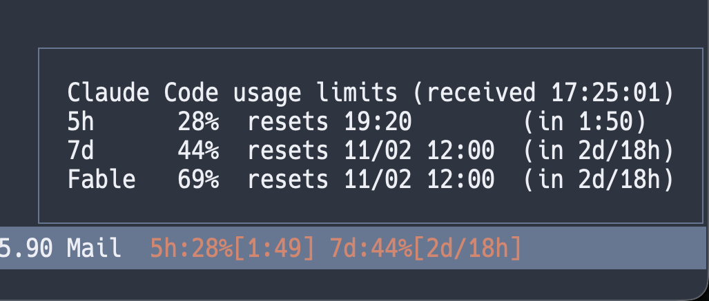
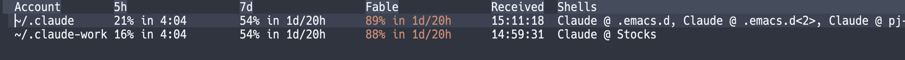

#+title: agent-shell-usage-limits

Show the usage limits of your Claude subscription in the mode line of
[[https://github.com/xenodium/agent-shell][agent-shell]] buffers running Claude Code.

#+begin_example
 5h:10%[4:26] 7d:39%[4d/13h]
#+end_example

That is the 5-hour window at 10 percent with 4 hours 26 minutes until it
resets, and the 7-day window at 39 percent with 4 days 13 hours to go: the
same numbers that =/usage= shows in the Claude Code CLI.

Holding mouse-1 on the display shows the details, including the weekly
window of the models a plan includes at a limited share:

* How it works

Claude Code tells its front ends about the account's usage limits with the
Agent SDK's =rate_limit_event=.  claude-agent-acp, the ACP adapter that
agent-shell runs Claude Code through, forwards each of those as a
=usage_update= notification whose =_meta= carries the event's data as
=_claude/rateLimit=.  agent-shell 0.89 and later hand that =_meta= to
subscribers of the =usage-update= event.  This package subscribes to the
event in agent-shell buffers connected to Claude Code, keeps the last
values received (the event only comes when a value changes) and shows them
in the mode line.

The values belong to the account, not to a session, so one set is shared by
all shells.

* Requirements

- Emacs 29.1 or later
- [[https://github.com/xenodium/agent-shell][agent-shell]] 0.89 or later
- [[https://github.com/agentclientprotocol/claude-agent-acp][claude-agent-acp]] 0.42 or later, the adapter agent-shell uses for
  Claude Code
- Claude Code, logged in with a Claude subscription (Pro, Max, Team or
  Enterprise); API-key usage has no subscription windows
- [[https://github.com/tumashu/posframe][posframe]], optional, for the details popover

* Install

Not on MELPA yet.  With =package-vc-install= (Emacs 29):

#+begin_src emacs-lisp
(package-vc-install "https://github.com/analytical-engines/agent-shell-usage-limits")
#+end_src

With straight.el:

#+begin_src emacs-lisp
(straight-use-package
 '(agent-shell-usage-limits :type git :host github
                            :repo "analytical-engines/agent-shell-usage-limits"))
#+end_src

Or put =agent-shell-usage-limits.el= somewhere on your =load-path=.

* Setup

#+begin_src emacs-lisp
(require 'agent-shell-usage-limits)
(agent-shell-usage-limits-mode 1)
#+end_src

By default the display is added to the buffer-local =mode-line-misc-info=
of those buffers, the same way agent-shell adds its own mode line text, so
your =mode-line-format= is left alone.  See
=agent-shell-usage-limits-placement= for the other placements, including
placing =(:eval (agent-shell-usage-limits-string))= by hand.

Until the first update arrives the numbers are shown as asterisks.  Claude
Code sends the first one after the first prompt of a session.

* Details

=M-x agent-shell-usage-limits-describe= shows every window received so
far, with reset times:

#+begin_example
Claude Code usage limits (received 11:20:35)
5h      7%  resets 16:00        (in 4:39)
7d     40%  resets 11/02 14:00  (in 2d/23h)
Fable  61%  resets 11/02 14:00  (in 2d/23h)
#+end_example

The same popover appears while mouse-1 is held on the mode line display.
It uses posframe when installed and workable (graphical frames, and
terminal frames on Emacs 31), otherwise the echo area.

The third line is the weekly window of the models a plan includes at a
limited share (Claude Code calls it the Fable limit).  Claude Code only
reports it from sessions of that model, so the package keeps
each window separately: an update from an Opus session leaves the Fable
line as it was, marked with the time it was received when it is older than
the rest.

* Format

The mode line text is built from three customizable pieces:

| Variable                                     | Default        | Meaning                       |
|----------------------------------------------+----------------+-------------------------------|
| =agent-shell-usage-limits-mode-line-windows= | =(five_hour seven_day)= | windows shown, in order |
| =agent-shell-usage-limits-format=            | ="%l:%u%%[%r]"= | one window                   |
| =agent-shell-usage-limits-separator=         | =" "=          | between windows               |
| =agent-shell-usage-limits-mode-line-format=  | =" %w "=       | around the whole thing        |

In =agent-shell-usage-limits-format=, =%l= is the window's label, =%u= its
utilization as a whole percent, =%r= the time left until the reset, =%t=
the time of the reset and =%k= the window's key.  Width specs such as =%3u=
work.

To show the Fable window as well:

#+begin_src emacs-lisp
(setq agent-shell-usage-limits-mode-line-windows
      '(five_hour seven_day seven_day_overage_included))
#+end_src

The labels come from =agent-shell-usage-limits-window-labels=.  The text
takes the =warning= face from 80 percent and the =error= face from 95
percent of the highest window shown; see
=agent-shell-usage-limits-warning-threshold= and
=agent-shell-usage-limits-error-threshold=.

* Using the values elsewhere

The values are available to your own code:

#+begin_src emacs-lisp
(agent-shell-usage-limits-utilization 'five_hour)         ; => 7, or nil before the first update
(agent-shell-usage-limits-resets-at 'seven_day)           ; => 1793588400.0 (float-time)
(agent-shell-usage-limits-seconds-until-reset 'five_hour) ; => 12000.0
(agent-shell-usage-limits-window-keys)                    ; => (five_hour seven_day seven_day_overage_included)
(agent-shell-usage-limits-account-list)                   ; => ("/home/me/.claude" "/home/me/.claude-work")
#+end_src

Each takes an optional account (a config directory, see below).  Without
one, they read the current buffer's account in a shell, and the account
last updated anywhere else.

=agent-shell-usage-limits-update-functions= is a hook run with the
=_claude/rateLimit= alist each time a new one arrives.  For example, to be
told when the 5-hour window passes 80 percent:

#+begin_src emacs-lisp
(add-hook 'agent-shell-usage-limits-update-functions
          (lambda (_rate-limit)
            (when (>= (or (agent-shell-usage-limits-utilization 'five_hour) 0) 80)
              (message "Claude Code: 5-hour window at %d%%"
                       (agent-shell-usage-limits-utilization 'five_hour)))))
#+end_src

* Supported agents

Claude Code only.  Other agents do not report their usage limits over ACP
yet; codex-acp, for instance, keeps Codex's windows for its =/status=
command but does not put them in =_meta=
([[https://github.com/agentclientprotocol/codex-acp/issues/227][agentclientprotocol/codex-acp#227]]).
When one does, support means reading its =_meta= in
=agent-shell-usage-limits--on-usage-update= and listing its agent
identifier in =agent-shell-usage-limits-agent-identifiers=; pull requests
are welcome.

* Several accounts

The values belong to a Claude account, and the package keeps one set per
account.  A shell's account is the Claude Code config directory its agent
runs with: =CLAUDE_CONFIG_DIR=, or =~/.claude= when it is not set.  A
shell's mode line and details show its own account only; the details end
with a count of the other accounts.

=M-x agent-shell-usage-limits-list= shows every account in a table, one
row each, with a column per window, the time of the last update and the
account's open shells.  The table refreshes as updates arrive, =g=
refreshes it by hand and =RET= switches to a shell of the account on the
line.

Accounts are labelled with their directory.  To label them yourself:

#+begin_src emacs-lisp
(setq agent-shell-usage-limits-account-labels
      '(("/home/me/.claude" . "home")
        ("/home/me/.claude-work" . "work")))
#+end_src

=%a= in =agent-shell-usage-limits-mode-line-format= puts the label in the
mode line, for example =" %a %w "=.

There are two ways to run shells with different accounts.

*Per agent config.* =agent-shell-usage-limits-make-claude-code-config=
returns agent-shell's Claude Code config with another name and config
directory.  Add it to =agent-shell-agent-configs= and it appears in the
agent picker:

#+begin_src emacs-lisp
(add-to-list 'agent-shell-agent-configs
             (lambda ()
               (agent-shell-usage-limits-make-claude-code-config
                :name "Claude (work)" :config-dir "~/.claude-work")))
#+end_src

*Per project.* If a project's environment sets =CLAUDE_CONFIG_DIR=, for
example with direnv and an =.envrc= containing
=export CLAUDE_CONFIG_DIR=$HOME/.claude-work=, shells started from that
project use that account.  The agent gets the environment in effect when
it is started, so start the shell with a buffer of that project selected;
with emacs-direnv, which switches the global environment by selected
buffer, starting it from another project's buffer or from a sidebar gives
the agent the wrong environment.

Either way, Claude Code must be logged in once for each config directory:

#+begin_example
CLAUDE_CONFIG_DIR=~/.claude-work claude auth login
#+end_example

Status: tested with two config directories logged into one account, which
showed up as two accounts with their own values and rows.  Shells of
two different accounts, with different values, have not been tried yet;
reports are welcome.

* Limitations

- Accounts are told apart by config directory only, so two directories
  logged into the same account count as two accounts.  Using the account
  that Claude Code reports instead is planned.

* Acknowledgements

- [[https://github.com/xenodium][Alvaro Ramirez]] for agent-shell, and for adding the =usage-update=
  event with the agent's =_meta= to its public API when asked, which is
  what made this package possible without touching agent-shell's
  internals.
- The maintainers of [[https://github.com/agentclientprotocol/claude-agent-acp][claude-agent-acp]] for forwarding Claude Code's rate
  limit events over ACP as =_claude/rateLimit=.
- [[https://github.com/tumashu][Feng Shu]] for posframe, which draws the details popover.

* License

GPL-3.0-or-later.  See [[file:LICENSE][LICENSE]].
